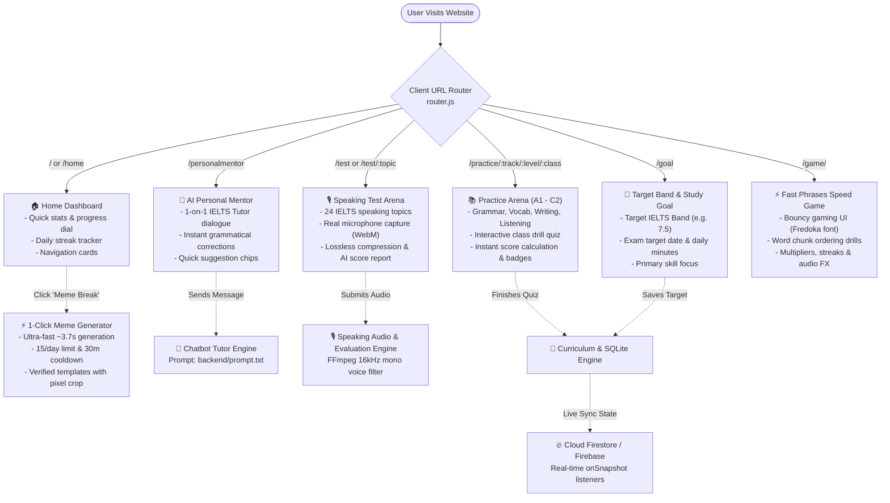
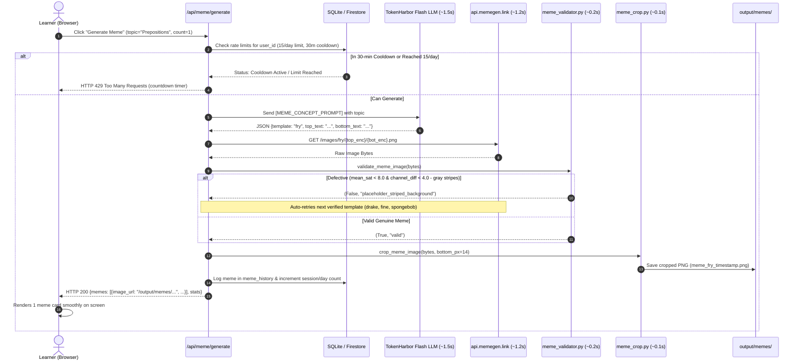
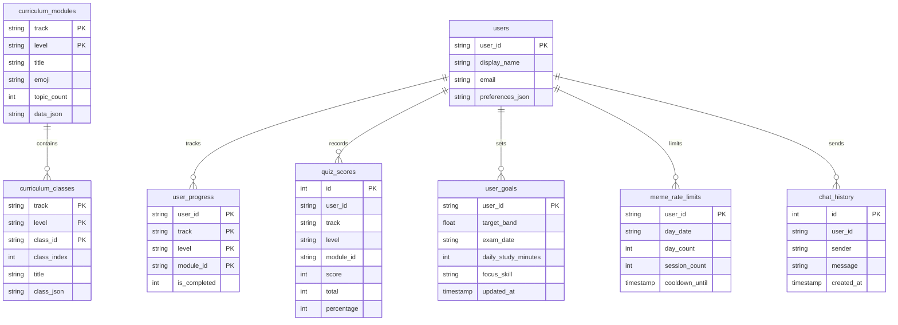

# AI English Coach — Complete Architecture, User Flow & Engine Specifications

> **System Overview**: AI English Coach is an end-to-end IELTS preparation, speech evaluation, and adaptive tutoring platform. It couples a responsive Vanilla JS Single-Page Application (SPA) with a modular Python backend (`backend/api`), specialized processing engines, local SQLite persistence (`backend/database/app.db`), and a real-time Google Cloud Firestore synchronization architecture for live cross-device state management.

---

## 1. Architectural Plan & Engine Breakdown

### The 7 Core Engines of the Platform

| Engine | Primary Role | Core Technologies | Input & Output |
| :--- | :--- | :--- | :--- |
| **Meme Engine** | Generates relatable English learning memes in **~3.7s**, filters defective placeholder artifacts, and crops watermarks. | `deepseek-v4.1-flash:free`, `mimo-v2.6-flash:free`, TokenHarbor API, Pillow (PIL), NumPy, `requests.Session()`, SQLite | **In**: Topic (e.g. "Prepositions")<br/>**Out**: Validated, cropped PNG & metadata |
| **Speaking & Audio Engine** | Captures real microphone voice, applies lossless audio compression (16kHz mono), transcribes, and scores IELTS band. | `MediaRecorder` API, FFmpeg, Google Speech / Whisper, `deepseek-v4.1-flash:free`, Gemini Flash | **In**: Spoken audio blob (WebM/WAV)<br/>**Out**: Band 0–9, 4 Criteria, Gap Analysis, Model Upgrades |
| **Personal Mentor / Chatbot Engine** | Delivers 1-on-1 tutoring drills, error analysis, and adaptive pedagogical coaching with rolling memory. | OpenAI SDK, `tiktoken`, Regex injection filter, TokenHarbor / OpenRouter, SQLite `chat_history` | **In**: Learner chat message & feedback JSON<br/>**Out**: 2–4 sentence pedagogical coaching response |
| **Curriculum & Storage Engine** | Manages CEFR level syllabi (A1–C2), class quizzes, learner progress, and score history. | SQLite 3 (`app.db`), Python `sqlite3`, JSON schema | **In**: Track, Level, Class ID, Quiz score<br/>**Out**: Indexed class drills & persistent score stats |
| **Dynamic Prompt Engine** | Centralizes all AI system instructions for real-time tweaking without code changes. | `backend/prompt.txt`, `prompt_loader.py` (`os.path.getmtime` auto-reload) | **In**: Prompt section key (`[IELTS_COACH_PROMPT]`)<br/>**Out**: Active prompt text string |
| **Speed Sentence Game Engine** | Interactive timed game ("Fast Phrases") for speed syntax assembly with audio effects and combos. | HTML5 Canvas, Web Audio API, `backend/game/index.html` (served on `/game/`) | **In**: Scrambled sentence chunks & user clicks<br/>**Out**: Speed score, streak multipliers, rank evaluation |
| **Cloud Live Sync Engine** *(Roadmap & Cloud Spec)* | Real-time cloud persistence across multiple tabs and devices with offline-first caching. | Google Cloud Firestore, Firebase Auth, `firebase-admin`, Firebase Hosting CDN | **In**: User goal, quiz score, chat message<br/>**Out**: Instant real-time live sync (`onSnapshot`) |

---

## 2. High-Level User Flow Diagram



---

## 3. End-to-End System Architecture & Data Flow

```mermaid
graph TB
    subgraph Frontend ["1. Frontend Web Client (UI/ - Vanilla JS & CSS SPA)"]
        UI_Router["URL Router (router.js)<br/>Deep links: /home, /goal, /practice/:track/:level/:classId, /test"]
        UI_Chat["chat.js (AI Mentor dialogue & history reload)"]
        UI_Speaking["test.js (Real Mic WebM recorder & score dial)"]
        UI_Practice["modulepractice.js & practiceUI.js (Class drills & CEFR cards)"]
        UI_Meme["api.js (Fast 1-click meme generator & cooldowns)"]
        UI_Design["Gaming Design System<br/>Fredoka + Nunito fonts, Semi-bold 600 styling"]
    end

    subgraph API_Gateway ["2. Structured FastAPI Application Layer (backend/api/)"]
        App["backend.api.app (FastAPI App, CORS & Defensive CSP Headers)"]
        R_System["routes/system.py (/api/health, /api/routes, /api/prompts)"]
        R_Auth["routes/auth.py (/api/auth/status, /api/auth/preferences)"]
        R_Modules["routes/modules.py (/api/modules/..., /api/progress, /api/scores)"]
        R_Chat["routes/chat.py (/api/chat, /api/chat/history/{user_id})"]
        R_Meme["routes/memes.py (/api/meme/status, /api/meme/generate)"]
        R_Speaking["routes/speaking.py (/api/speaking/evaluate, /api/speaking/verify-compression)"]
        R_Goal["routes/goals.py (/api/goal/{user_id})"]
        Mount_Game["Static Mount (/game/ -> backend/game/index.html)"]
    end

    subgraph Engines ["3. Specialized Processing & AI Engines"]
        PromptEngine["Dynamic Prompt Engine (prompt_loader.py)<br/>Reads backend/prompt.txt on mtime change"]
        MemeEngine["⚡ Meme Engine (~3.7s)<br/>DeepSeek / MIMO LLM + Memegen API + meme_validator + meme_crop"]
        SpeakingEngine["🎙️ Speaking Engine<br/>FFmpeg Lossless Voice Filter + audio_to_txt + DeepSeek / Gemini LLM"]
        ChatEngine["💬 Chatbot Engine<br/>Rolling Memory + Injection Filter + TokenHarbor LLM"]
    end

    subgraph Storage ["4. Persistence & Live Cloud Synchronization"]
        LocalDB[("Local SQLite 3 (backend/database/app.db)<br/>curriculum_modules, quiz_scores, chat_history, user_goals")]
        CloudDB[("🔥 Google Cloud Firestore<br/>Live onSnapshot push for goals, scores & chat history")]
        CloudAuth["Firebase Auth (Anonymous Guest & Google Login)"]
    end

    UI_Router --> App
    UI_Chat --> R_Chat
    UI_Speaking --> R_Speaking
    UI_Practice --> R_Modules
    UI_Meme --> R_Meme
    UI_Design -.-> Frontend

    R_System --> PromptEngine
    R_Chat --> ChatEngine
    R_Chat --> PromptEngine
    R_Meme --> MemeEngine
    R_Meme --> PromptEngine
    R_Speaking --> SpeakingEngine
    R_Speaking --> PromptEngine
    R_Modules --> LocalDB
    R_Goal --> LocalDB
    R_Auth --> LocalDB
    R_Meme --> LocalDB

    LocalDB -.->|Cloud Mirror & Live Stream| CloudDB
    CloudDB -.->|Live onSnapshot events| Frontend
    CloudAuth -.-> Frontend
```



---

## 4. Deep-Dive: Meme Engine Specification

### What the Meme Engine Does
The **Meme Engine** generates culturally relevant, humorous English learning and IELTS memes on demand. It enforces strict pedagogical humor, filters broken placeholder templates, crops external branding watermarks using pixel offsets, and prevents spam via rate-limiting.

### Performance Optimization (~3.7s Response)
1. **Model Selection**: Uses `deepseek-v4.1-flash:free` / `mimo-v2.6-flash:free` with a 4.5s client timeout.
2. **Session Reuse**: Persistent `requests.Session()` with connection pooling.
3. **Single-Concept Prompt Shortcut**: Calls `[MEME_CONCEPT_PROMPT]` for instantaneous structured JSON extraction.
4. **2-Step Candidate Verification**: Bypasses heavy candidate retries; tests top candidates with 2.0s timeout and falls back to verified templates.
5. **Smart Topic-Aware Fallback**: If upstream Memegen has network delays, immediately synthesizes high-quality text for one of the 19 verified templates.

### Data Flow & Execution Pipeline



---

## 5. Deep-Dive: Speaking Audio & Lossless Evaluation Engine

### What the Speaking Engine Does
The **Speaking Engine** evaluates IELTS spoken English across the 4 official assessment pillars: **Fluency & Coherence**, **Lexical Resource**, **Grammatical Range & Accuracy**, and **Pronunciation**. It compresses candidate audio to minimize bandwidth while mathematically verifying zero loss in phonetic clarity, transcribes the speech, and generates structured gap analysis reports.

### Audio Preprocessing & Lossless Compression
- **Client Capture**: Web Audio API `MediaRecorder` captures real WebM audio chunks and returns a guaranteed Promise upon `onstop`.
- **FFmpeg Voice Filter**:
  ```bash
  ffmpeg -y -i input.webm -ar 16000 -ac 1 -c:a pcm_s16le -af "silenceremove=start_periods=1:start_duration=0.2:start_threshold=-45dB" output.wav
  ```
- **Evaluation Speed**: Evaluator sets `verify_compression=False` by default for fast ~3.0s evaluations, while `/api/speaking/verify-compression` remains available for diagnostic audits.

### IELTS Score Response Structure
```json
{
  "overall_band": 7.5,
  "cefr_level": "C1",
  "fluency_and_coherence": { "band": 7.5, "feedback": "Natural tempo with minimal hesitation." },
  "lexical_resource": { "band": 7.0, "feedback": "Strong idiomatic range with occasional imprecise collocation." },
  "grammatical_range_and_accuracy": { "band": 7.5, "feedback": "Good variety of complex sentence structures." },
  "pronunciation": { "band": 8.0, "feedback": "Clear intonation and rhythm." },
  "gap_analysis": {
    "pause_frequency": "You paused 3 times — work on flow using connectors like 'well', 'actually'.",
    "vocabulary_gaps": "Limited topic vocabulary — try synonyms for 'important': crucial, vital, paramount."
  },
  "where_to_improve": {
    "what_you_should_have_said": "Furthermore, the experience broadened my horizons.",
    "high_band_snippet": "The breathtaking scenery left me utterly speechless.",
    "better_connectors": ["In contrast", "Consequently", "To illustrate"],
    "focus_topics_next": ["Technology", "Culture", "Sports"]
  }
}
```

---

## 6. Deep-Dive: AI Personal Mentor / Chatbot Engine

### What the Chatbot Engine Does
The **Chatbot Engine** acts as an adaptive 1-on-1 IELTS mentor. Instead of giving long, overwhelming lectures, it follows a strict pedagogical format: **What you did well** (evidence-based), **Let's improve this** (model example), and **Your turn** (focused single practice task).

### Dynamic Architecture & Memory
- **Dynamic System Prompt**: Loaded from `[IELTS_COACH_PROMPT]` in `backend/prompt.txt`. Edits take effect immediately without restarting the server.
- **Persistent SQLite Dialogue**: Every turn is recorded in `chat_history` (`user_id`, `sender`, `message`, `created_at`).
- **History Reload**: The client fetches `/api/chat/history/{user_id}` on mount to restore the conversational thread.

---

## 7. Deep-Dive: Curriculum & Database Engine

### Schema Architecture


---

## 8. Cloud Database & Live Synchronization Specification (Firebase Firestore)

### The Cloud Problem & Motivation
In cloud container environments (Google Cloud Run / Kubernetes), filesystem storage is **ephemeral**. When the server container scales or restarts, local SQLite files reset. Storing user state in **Google Cloud Firestore** solves this by providing:
1. **Persistent Global Storage**: User study goals, test scores, and chat logs survive container restarts.
2. **Real-Time Live Updates (`onSnapshot`)**: Changes made on one device or tab immediately push to the UI without polling or page refreshes.
3. **Offline Caching**: Browser-side IndexedDB caching allows learners with spotty connectivity to practice uninterrupted.

### Live Cloud Architecture

```mermaid
graph LR
    subgraph Browser ["Learner Browser"]
        ClientApp["Single Page App (UI/js)"]
        LiveListener["Firestore onSnapshot Listener"]
    end

    subgraph FirebaseCloud ["Google Firebase / Cloud"]
        FirestoreDB[("🔥 Cloud Firestore<br/>users/{userId}/...")]
        FirebaseAuth["Firebase Auth<br/>(Anonymous & Google Sign-In)"]
    end

    subgraph CloudRun ["FastAPI Backend (Cloud Run)"]
        FastAPIApp["FastAPI Server"]
        AdminSDK["firebase-admin SDK"]
        AIEngines["DeepSeek / Gemini / MIMO"]
    end

    ClientApp -- "1. Real-time reads & writes" --> FirestoreDB
    LiveListener <-- "2. Instant live data push" -- FirestoreDB
    ClientApp -- "3. Microphone audio & AI prompts" --> FastAPIApp
    FastAPIApp --> AIEngines
    FastAPIApp -- "4. Save verified score report" --> AdminSDK --> FirestoreDB
```

### Firestore Collection Mapping
* `users/{userId}`: User profile, target band (e.g. 7.5), daily study minutes, exam date.
* `users/{userId}/chat_history/{messageId}`: Complete dialogue history with the AI mentor.
* `users/{userId}/quiz_scores/{quizId}`: Module scores, percentages, and completed badges.
* `users/{userId}/speaking_evaluations/{testId}`: Band scores, gap analyses, model upgrades.
* `curriculum/{track}/levels/{level}/classes/{classId}`: Shared public syllabus content.

---

## 9. Production Containerization & Cloud Deployment Flow

### Docker Container Specification (`Dockerfile`)
- **Base Image**: `python:3.11-slim`
- **System Dependencies**: `ffmpeg` (audio compression) and `curl` (container health checks).
- **Security**: Non-root application user (`appuser:appuser`, UID 1000).
- **Healthcheck**: `curl -f http://localhost:8080/api/health || exit 1`
- **Entrypoint**: `python3 -m uvicorn backend.server:app --host 0.0.0.0 --port 8080`

### Firebase Hosting CDN & Cloud Run Integration (`firebase.json`)
```json
{
  "hosting": {
    "public": "UI",
    "rewrites": [
      { "source": "/api/**", "run": { "serviceId": "ai-english-coach", "region": "us-central1" } },
      { "source": "/output/**", "run": { "serviceId": "ai-english-coach", "region": "us-central1" } },
      { "source": "**", "destination": "/index.html" }
    ]
  }
}
```

### Automated Deployment (`deploy_to_firebase.sh`)
```bash
./deploy_to_firebase.sh
```
1. Builds and deploys the container to Google Cloud Run (`gcloud run deploy ai-english-coach --source .`).
2. Deploys the static UI assets and CDN rewrites to Firebase Hosting (`firebase deploy --only hosting`).
3. Application becomes globally accessible via `https://[PROJECT_ID].web.app`.
