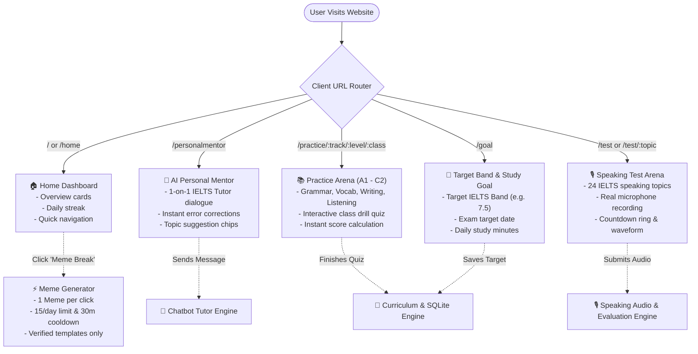
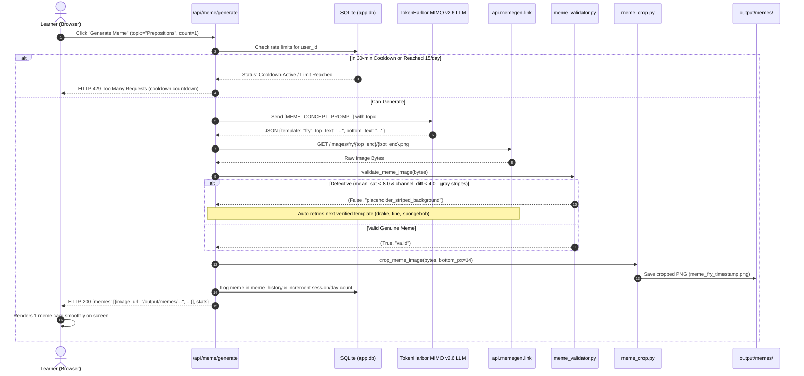
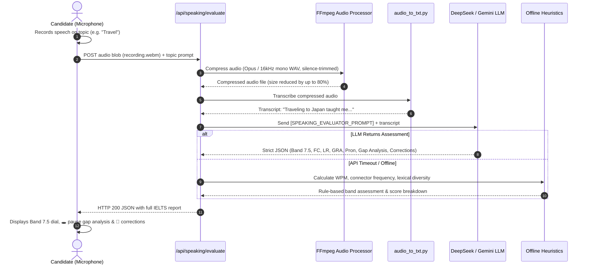
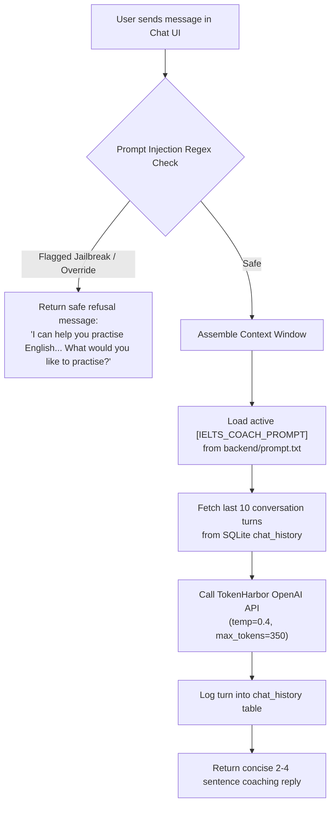
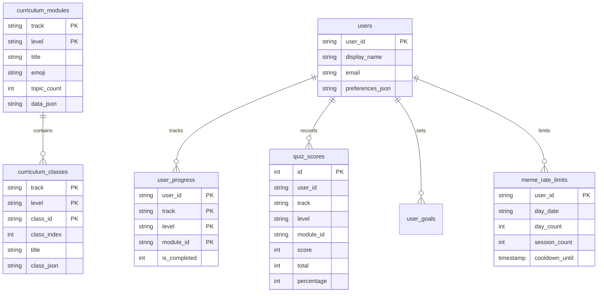

# AI English Coach — Complete Architecture, User Flow & Engine Specifications

> **System Overview**: AI English Coach is an end-to-end IELTS preparation, speech evaluation, and adaptive tutoring platform. It couples a responsive Vanilla JS Single-Page Application (SPA) with a modular Python backend (`backend/api`) backed by SQLite persistence (`backend/database/app.db`) and specialized processing engines.

---

## 1. Architectural Plan & Engine Breakdown

### The 5 Core Engines of the Platform

| Engine | Primary Role | Core Technologies | Input & Output |
| :--- | :--- | :--- | :--- |
| **Meme Engine** | Generates relatable English learning memes (1 per click), filters defective placeholders, and crops watermarks. | `mimo-v2.6-flash:free`, TokenHarbor API, Pillow (PIL), NumPy, `requests`, SQLite | **In**: Topic (e.g. "Prepositions") **Out**: Validated, cropped PNG & metadata |
| **Speaking & Audio Engine** | Captures real microphone voice, applies lossless audio compression, transcribes, and scores IELTS band. | `MediaRecorder` API, FFmpeg, Google Speech / Whisper, `deepseek-v4.1-flash:free`, Gemini Flash | **In**: Spoken audio blob (WebM/WAV) **Out**: Band 0–9, Gap Analysis, Corrections |
| **Personal Mentor / Chatbot Engine** | Delivers 1-on-1 tutoring drills, error analysis, and adaptive pedagogical coaching. | OpenAI SDK, `tiktoken`, Regex injection filter, TokenHarbor / OpenRouter | **In**: Learner chat message & feedback JSON **Out**: 2–4 sentence pedagogical coaching response |
| **Curriculum & Storage Engine** | Manages CEFR level syllabi (A1–C2), class quizzes, learner progress, and score history. | SQLite 3 (`app.db`), Python `sqlite3`, JSON schema | **In**: Track, Level, Class ID, Quiz score **Out**: Indexed class drills & persistent score stats |
| **Dynamic Prompt Engine** | Centralizes all AI system instructions for real-time tweaking without code changes. | `backend/prompt.txt`, `prompt_loader.py` (`os.path.getmtime` auto-reload) | **In**: Prompt section key (`[IELTS_COACH_PROMPT]`) **Out**: Active prompt text string |

---

## 2. High-Level User Flow Diagram

---

## 3. End-to-End System Architecture & Data Flow

```mermaid
graph TB
    subgraph Frontend ["1. Frontend Web Client (UI/ - Vanilla JS & CSS SPA)"]
        UI_Router["URL Router (router.js)<br/>Handles /home, /goal, /practice/:track/:level/:classId"]
        UI_Chat["chat.js (AI Mentor dialogue)"]
        UI_Speaking["speaking.js (Voice recorder & Waveform)"]
        UI_Practice["modulepractice.js & practiceUI.js (Class drills)"]
        UI_Meme["meme.js (1-click generator & cooldown timer)"]
    end

    subgraph API_Gateway ["2. Structured FastAPI Application Layer (backend/api/)"]
        App["backend.api.app (FastAPI App & CORS)"]
        R_System["routes/system.py (/api/health, /api/routes, /api/prompts)"]
        R_Auth["routes/auth.py (/api/auth/status, /api/auth/preferences)"]
        R_Modules["routes/modules.py (/api/modules/..., /api/progress, /api/scores)"]
        R_Chat["routes/chat.py (/api/chat, /api/chat/history)"]
        R_Meme["routes/memes.py (/api/meme/status, /api/meme/generate)"]
        R_Speaking["routes/speaking.py (/api/speaking/evaluate, /api/speaking/topics)"]
        R_Goal["routes/goals.py (/api/goal/{user_id})"]
    end

    subgraph Engines ["3. Specialized Processing & AI Engines"]
        PromptEngine["Dynamic Prompt Engine (prompt_loader.py)<br/>Reads backend/prompt.txt on mtime change"]
        MemeEngine["⚡ Meme Engine<br/>MIMO LLM + Memegen API + meme_validator + meme_crop"]
        SpeakingEngine["🎙️ Speaking Engine<br/>FFmpeg Lossless Compression + audio_to_txt + DeepSeek LLM"]
        ChatEngine["💬 Chatbot Engine<br/>Context window + Injection Filter + TokenHarbor LLM"]
    end

    subgraph Storage ["4. Persistent Database (backend/database/app.db)"]
        DB_Modules["curriculum_modules & curriculum_classes (A1-C2 syllabi)"]
        DB_Progress["user_progress & quiz_scores (Completions & stats)"]
        DB_Memes["meme_history & meme_rate_limits (15/day quota, 30m cooldown)"]
        DB_Goals["user_goals & users (Target band & preferences)"]
    end

    UI_Router --> App
    UI_Chat --> R_Chat
    UI_Speaking --> R_Speaking
    UI_Practice --> R_Modules
    UI_Meme --> R_Meme

    R_System --> PromptEngine
    R_Chat --> ChatEngine
    R_Chat --> PromptEngine
    R_Meme --> MemeEngine
    R_Meme --> PromptEngine
    R_Speaking --> SpeakingEngine
    R_Speaking --> PromptEngine
    R_Modules --> DB_Modules
    R_Modules --> DB_Progress
    R_Goal --> DB_Goals
    R_Auth --> DB_Goals
    R_Meme --> DB_Memes
```

---

## 4. Deep-Dive: Meme Engine Specification

### What the Meme Engine Does
The **Meme Engine** generates culturally relevant, humorous English learning and IELTS memes on demand. It enforces strict pedagogical humor, filters broken placeholder templates, crops external branding watermarks using pixel offsets, and prevents spam via rate-limiting.

### Technical Stack
- **AI Concept Generation**: `mimo-v2.6-flash:free` via TokenHarbor API (temperature: 0.85).
- **Template Source**: `api.memegen.link` with a curated catalog of 19 verified templates.
- **Image Validation & Defect Detection**: `backend/meme_generator/meme_validator.py` using NumPy & Pillow (PIL) for color saturation and channel variance analysis.
- **Watermark & Label Cropping**: `backend/meme_generator/meme_crop.py` for pixel-based margin cropping.
- **Local Card Renderer Fallback**: Pillow (`ImageDraw`, `ImageFont`) rendering dark-mode styled meme cards when offline.
- **Rate Limit & History Storage**: SQLite (`meme_rate_limits`, `meme_history`).

### Data Flow & Execution Pipeline

---

## 5. Deep-Dive: Speaking Audio & Lossless Evaluation Engine

### What the Speaking Engine Does
The **Speaking Engine** evaluates IELTS spoken English across the 4 official assessment pillars: **Fluency & Coherence**, **Lexical Resource**, **Grammatical Range & Accuracy**, and **Pronunciation**. It compresses candidate audio to minimize bandwidth while mathematically verifying zero loss in phonetic clarity, transcribes the speech, and generates structured gap analysis reports.

### Technical Stack
- **Client Capture**: Web Audio API `navigator.mediaDevices.getUserMedia` & `MediaRecorder` (mimeType: `audio/webm;codecs=opus`).
- **Audio Pre-processing & Compression**: `ffmpeg` (mono downmixing, 16kHz resample, silence trimming `-af silenceremove`).
- **Speech-to-Text Transcribers**: `backend/audio_to_txt.py` (Google Web Speech API / local Whisper engine).
- **Compression Lossless Verification**: Transcribes original vs compressed audio to guarantee identical word accuracy.
- **Examiner Scoring LLM**: `deepseek-v4.1-flash:free` / `gemini-2.5-flash` via TokenHarbor / Google GenAI.
- **Fallback Heuristics**: Python rule-based NLP calculator (speech pace WPM, Type-Token Ratio lexical diversity, discourse connector counters).

### Data Flow & Execution Pipeline

---

## 6. Deep-Dive: AI Personal Mentor / Chatbot Engine

### What the Chatbot Engine Does
The **Chatbot Engine** acts as an adaptive 1-on-1 IELTS mentor. Instead of giving long lectures, it follows a strict pedagogical format: **What you did well** (evidence-based), **Let's improve this** (model example), and **Your turn** (focused single practice task).

### Technical Stack
- **Provider & Models**: OpenRouter / TokenHarbor (`deepseek-v4.1-flash:free`, `mimo-v2.6-flash:free`).
- **Prompt Isolation**: System prompt loaded dynamically from `[IELTS_COACH_PROMPT]` in `backend/prompt.txt`.
- **Security & Safety**: Prompt injection regex sanitizer (`INJECTION_PATTERNS`).
- **Token Truncation**: Rolling conversation buffer preserving last 10 turns.
- **Persistence**: SQLite `chat_history` table.

---

## 7. Deep-Dive: Curriculum & Database Engine

### What the Database Engine Does
Stores and serves all curriculum levels, class drills, user progress, and score logs with sub-millisecond SQLite queries.

### Schema Architecture

