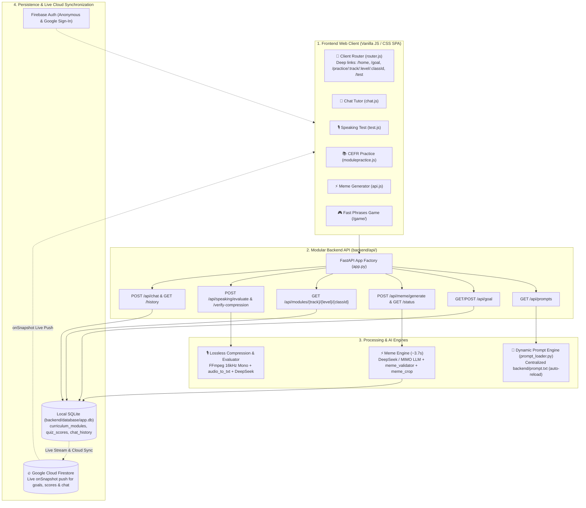

# AI English Coach 🎙️✨

**AI English Coach** is a modern, modular AI-powered web platform and speech practice engine designed for IELTS, TOEFL, and CEFR English fluency preparation.

The application combines an interactive Single Page Application (SPA) frontend with a high-performance Python FastAPI backend, offering an **AI Personal Mentor**, an **A1–C2 Modular Practice Arena** (Grammar, Vocabulary, Listening, Writing), a **Real-Time Speaking Test Simulator with Lossless Audio Compression**, an **Ultra-Fast AI Meme Learning Engine (~3.7s)**, a **Fast Phrases Speed Sentence Game**, and a **Cloud Live Sync Architecture (Google Cloud Firestore)**.

---

## 🌟 Key Application Features

### 1. 💬 AI Personal Mentor & Conversational Coach
- **Adaptive Pedagogical Tutor**: Real-time 1-on-1 coaching for IELTS Speaking and general conversation drills.
- **Contextual Feedback**: Instant correction of grammatical errors, vocabulary alternatives, and natural phrasing suggestions.
- **Quick-Suggestion Chips**: Click-to-ask prompts (*"Correct my grammar"*, *"Teach me idioms"*, *"Practice Part 2 Speaking"*).
- **Persistent Chat History**: Session messages stored securely in SQLite (`chat_history`) with rolling conversation context.

### 2. 📚 Practice Arena (CEFR A1–C2 Curricula)
- **Full CEFR Syllabi**: Comprehensive structured syllabi for **Grammar**, **Vocabulary**, **Listening**, and **Writing** across CEFR levels (A1 to C2).
- **Class-Level Drills**: Deep-linked interactive quizzes (e.g. `/practice/grammar/a1/class02`) with tap-to-reveal answer keys and star-difficulty ratings.
- **Database-Backed Modules**: Curricula stored and retrieved directly from SQLite (`curriculum_modules` & `curriculum_classes`).
- **Live Progress & Scoring**: Automatically tracks module completion and quiz scores in `user_progress` and `quiz_scores`.

### 3. 🎙️ Speaking Test Simulation (Real-Time Audio & IELTS AI)
- **24 Curated Topics**: IELTS Part 1, 2, and 3 topics categorized by difficulty (*Easy*, *Medium*, *Hard*) with a *🎲 Surprise Me* randomizer.
- **Microphone Recorder**: Browser-based audio capture via `MediaRecorder` API with waveform visualization and countdown timer.
- **Lossless Audio Preprocessing**:
  - Compresses audio via FFmpeg (`16kHz, mono, PCM 16-bit WAV` voice filter) before sending to LLM.
  - Zero-loss speech quality verification comparing transcriptions via `audio_to_txt.transcribe_audio`.
- **Comprehensive IELTS Score Report**:
  - **4 Assessment Criteria**: Fluency & Coherence, Lexical Resource, Grammatical Range & Accuracy, Pronunciation (Band 1.0–9.0).
  - **📊 Gap Analysis**: Pause frequency detection (🕳️) and vocabulary repetition alerts (📚).
  - **🚀 Targeted Recommendations**: Model answer upgrades (*"What you should have said"*), advanced transitional connectors, and next focus areas.

### 4. ⚡ Ultra-Fast 1-Click Meme Engine (~3.7s)
- **Humorous English Learning**: Generates relatable grammar and IELTS memes via Flash LLMs (`deepseek-v4.1-flash:free` / `mimo-v2.6-flash:free`) and Memegen API in under 4 seconds.
- **Defective Placeholder Filtering (`meme_validator.py`)**: Automatically detects and rejects blank or striped background placeholders (e.g., low-saturation gray artifacts) and regenerates verified templates.
- **Pixel-Accurate Watermark Cropping (`meme_crop.py`)**: Configurable pixel cropping to eliminate external border watermarks.
- **Rate-Limiting Quotas**: 1 meme per click, 15 memes/day quota, and an automated 30-minute cooldown enforced via SQLite.

### 5. 🎮 Fast Phrases: Speed Sentence Building Game
- **Interactive Syntax Drills**: Timed speed building game located at `/game/` with vibrant sound effects, streak multipliers, and ranks.
- **Adaptive Vocabulary**: Scrambled chunks across categories (Daily Routine, Travel, Food, Work, Nature) to train automatic grammatical parsing.

### 6. 🎨 Playful Gaming Design System
- **Typography**: Paired gaming display font **Fredoka** (`wght@400;500;600;700`) with rounded body font **Nunito** (`wght@400;500;600;700`).
- **Harmonious Weight Standards**: Enforces semi-bold (`font-weight: 600`) across all headings, cards, badges, and action buttons.

### 7. 🔥 Cloud Database & Live Synchronization (Firebase Firestore Spec)
- **Persistent Global State**: User study goals, test scores, and chat logs synchronize with **Google Cloud Firestore**.
- **Real-Time Live Updates (`onSnapshot`)**: Cross-device and multi-tab live sync without polling or refreshing.
- **Stateless Cloud Run Backend**: Connects via `firebase-admin` with local SQLite as an offline fallback.

---

## 🧭 Client-Side URL Routing

The application features a client-side URL router (`router.js`) integrated with FastAPI SPA fallbacks, allowing direct deep-linking and browser navigation:

| Route Pattern | View / Section | Description |
|---|---|---|
| `/home` | Dashboard / Chat | Overview, quick stats, and chat tutor |
| `/personalmentor` | AI Chat Coach | Dedicated conversational coaching screen |
| `/goal` | Study Targets | Target band, exam date, and daily study minutes |
| `/test` | Speaking Arena | 24 IELTS speaking topics catalog |
| `/test/:topicId` | Speaking Simulation | Live voice recording for specific topic (e.g. `/test/travel`) |
| `/practice` | Practice Overview | Track selector (Grammar, Vocab, Listening, Writing) |
| `/practice/:track` | Track Level Selector | CEFR level grid (A1, A2, B1, B2, C1, C2) |
| `/practice/:track/:level` | Level Syllabus Grid | Class module list for selected level (e.g. `/practice/grammar/a1`) |
| `/practice/:track/:level/:classId` | Class Quiz & Drill | Interactive exercises for specific class (e.g. `/practice/grammar/a1/class02`) |
| `/game/` | Speed Sentence Game | Timed sentence assembling arena ("Fast Phrases") |

---

## 🏗️ System Architecture & Data Flow

Detailed visual architecture and complete sequence diagrams are documented in [`ARCHITECTURE_AND_USER_FLOW.md`](ARCHITECTURE_AND_USER_FLOW.md) and [`docs/ARCHITECTURE_AND_USER_FLOW.md`](docs/ARCHITECTURE_AND_USER_FLOW.md).



---

## 📁 Repository Structure

```text
├── UI/                                  # Frontend client application
│   ├── index.html                       # Single-page application entry point
│   ├── css/                             # Modular styling
│   │   ├── base.css                     # Tokens, Fredoka/Nunito typography, reset
│   │   ├── layout.css                   # Header, app shell, tabs
│   │   ├── components.css               # Buttons, cards, badges, modal
│   │   ├── chat.css                     # Chat bubbles, input bar
│   │   ├── practice.css                 # Practice arena & syllabi
│   │   └── test.css                     # Waveform, timer, score report
│   └── js/                              # Modular ES scripts
│       ├── router.js                    # Client-side router & path parameters
│       ├── api.js                       # Centralized backend API client
│       ├── auth.js                      # User session & preferences state
│       ├── chat.js                      # Chatbot dialogue interactions
│       ├── test.js                      # Voice recording, timer, evaluation UI
│       ├── data.js                      # Topics catalog & fallback content
│       └── practice/                    # CEFR practice sub-modules
│           ├── modulepractice.js        # Syllabus loader & class drill views
│           ├── practiceUI.js            # Category & level grid renderers
│           └── components/              # Cards, layout, learning widgets
│
├── backend/                             # Python backend application
│   ├── server.py                        # Uvicorn entry point
│   ├── prompt.txt                       # Centralized master system prompts
│   ├── prompt_loader.py                 # Dynamic prompt loader with auto-reload
│   ├── audio_to_txt.py                  # Audio transcription engine
│   ├── chatbot.py                       # Personal mentor conversation engine
│   ├── mp3_txt_speaking_evaluator.py    # FFmpeg lossless compression & IELTS scoring
│   ├── game/                            # Fast Phrases Speed Sentence Game
│   │   └── index.html                   # Interactive browser sentence assembly game
│   ├── api/                             # Structured API package
│   │   ├── app.py                       # FastAPI factory, CORS, static & SPA mounts
│   │   ├── config.py                    # Environment & configuration paths
│   │   ├── models/schemas.py            # Pydantic request/response schemas
│   │   └── routes/                      # Domain-specific route controllers
│   │       ├── auth.py                  # Authentication & preferences
│   │       ├── chat.py                  # Tutor chat & history
│   │       ├── goals.py                 # Band targets & study minutes
│   │       ├── memes.py                 # Validated meme generation & quotas
│   │       ├── modules.py               # Database-backed CEFR syllabi
│   │       ├── speaking.py              # Audio evaluation & compression checks
│   │       └── system.py                # Health checks, route map & prompt inspection
│   ├── database/                        # Database persistence layer
│   │   ├── db.py                        # SQLite schema & query helpers
│   │   └── app.db                       # Active SQLite database file
│   └── meme_generator/                  # Humor engine
│       ├── meme_generator.py            # Fast Flash LLM concept & Memegen caller
│       ├── meme_validator.py            # Defective placeholder validator
│       └── meme_crop.py                 # Pixel watermark cropper
│
├── docs/                                # Project documentation
│   ├── ARCHITECTURE_AND_USER_FLOW.md    # Comprehensive system diagrams & specs
│   └── architecture_diagram.jpg         # Architecture diagram graphic
├── lessons/                             # Curriculum source texts (A1-C2)
├── checklist.txt                        # Master user command & postponed tasks log
├── Dockerfile                           # Production container specification
├── deploy_to_firebase.sh                # Google Cloud Run & Firebase deploy script
├── firebase.json                        # Firebase Hosting CDN rewrites
└── requirements.txt                     # Python dependencies
```

---

## 🚀 Getting Started

### 1. Prerequisites
- **Python**: 3.10 or higher
- **FFmpeg**: Required for audio compression and transcription (`brew install ffmpeg` on macOS, `sudo apt install ffmpeg` on Ubuntu)

### 2. Local Installation

```bash
# 1. Clone the repository
git clone https://github.com/rifatjahanazad-bd/AI-English-Coach.git
cd AI-English-Coach

# 2. Create and activate a virtual environment
python3 -m venv .venv
source .venv/bin/activate  # On Windows: .venv\Scripts\activate

# 3. Install dependencies
pip install -r requirements.txt
```

### 3. Environment Variables

Create a `.env` file in the root directory:

```ini
# TokenHarbor / OpenRouter API Key for LLM access
TOKENHARBOR_API_KEY=your_tokenharbor_api_key_here

# Optional: Google Gemini API Key
GEMINI_API_KEY=your_gemini_api_key_here
```

### 4. Running the Application

Start the FastAPI application:

```bash
python3 -m uvicorn backend.server:app --host 0.0.0.0 --port 3000 --reload
```

Once running, access:
- **Web Application**: [`http://localhost:3000/home`](http://localhost:3000/home)
- **Fast Phrases Speed Game**: [`http://localhost:3000/game/`](http://localhost:3000/game/)
- **Interactive Swagger API Docs**: [`http://localhost:3000/docs`](http://localhost:3000/docs)
- **Prompt Inspection Endpoint**: [`http://localhost:3000/api/prompts`](http://localhost:3000/api/prompts)

---

## 🐳 Containerization & Cloud Deployment

### Run via Docker
```bash
# Build the container
docker build -t ai-english-coach .

# Run the container
docker run -p 8080:8080 -e TOKENHARBOR_API_KEY=your_key ai-english-coach
```

### Deploy to Google Cloud Run & Firebase Hosting
```bash
# Ensure execution permission
chmod +x deploy_to_firebase.sh

# Run automated deployment
./deploy_to_firebase.sh
```

---

## 🛠️ Developer & CLI Utilities

### Centralized Prompt Editing
All AI system prompts are located in [`backend/prompt.txt`](backend/prompt.txt). Prompts are reloaded on modification automatically by `prompt_loader.py` without requiring server restarts.

### Microphone Transcription CLI (`audio_to_txt.py`)
Record audio and test transcription from the terminal:
```bash
# Record for 60 seconds and transcribe
python backend/audio_to_txt.py --duration 60

# Transcribe an existing audio file
python backend/audio_to_txt.py --file input/sample.wav
```

### Terminal Meme Generator (`meme_generator.py`)
```bash
# Generate meme on a custom topic
python backend/meme_generator/meme_generator.py --topic "Third Conditionals"
```

---

## 📄 License

MIT License. Open for educational, personal practice, and open-source contributions.
