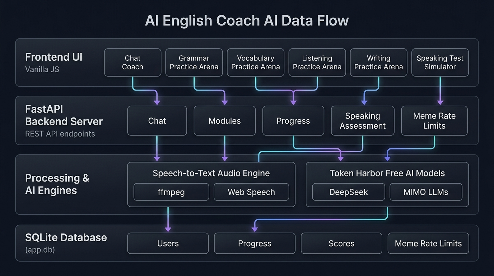
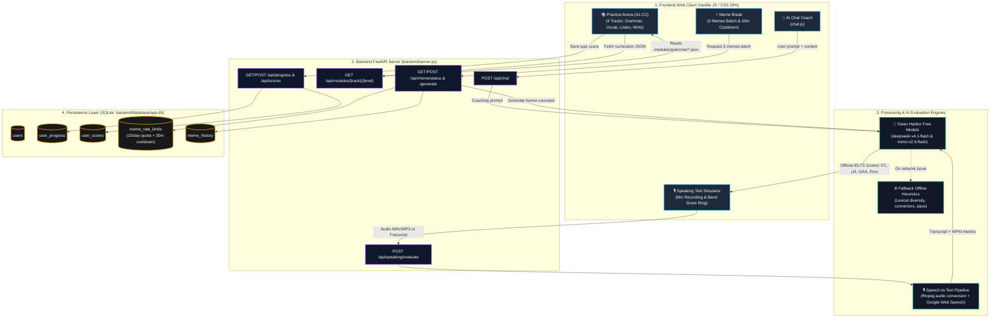

# AI English Coach 🎙️✨

**AI English Coach** is a modern, modular AI-powered web application and speech practice tool designed for IELTS, TOEFL, and fluency preparation.

It features an interactive frontend with an **AI Chat Coach**, a **4-Track Practice Arena** (Grammar, Vocabulary, Listening, Writing), and a **Full Speaking Test Simulator**, alongside **VocalPrep**, a Python-based audio capture and transcription engine.

---

## 🌟 Application Highlights

### 1. 💬 AI Chat Coach
- Conversational English practice with instant feedback and grammar corrections.
- Quick-suggestion chips (e.g. *Correct my grammar*, *Teach me idioms*, *Roleplay a cafe order*).
- Modern sticky bottom input bar for a clean chat experience.

### 2. 📚 Practice Arena (4 Targeted Tracks)
- **Grammar Lessons**: Conditionals, inversion, passive voice, and complex connectors.
- **Vocabulary Lessons**: Band 8+ collocations, natural idioms, and topic-specific vocabulary.
- **Listening Tests**: Accent variation, connected speech comprehension, and note-taking.
- **Writing Lessons**: Essay introductions, thesis generation, and paragraph coherence.
- Real-time word counter and instant AI feedback with Band score analysis.

### 3. 🎙️ Speaking Test Simulation
- **24 IELTS Topics** categorized by difficulty (*Easy, Medium, Hard*) with a *🎲 Surprise Me* randomizer.
- Live microphone recorder with animated audio waveforms and a 5-minute countdown ring.
- Comprehensive IELTS score report covering **Fluency & Coherence**, **Lexical Resource**, **Grammatical Range**, and **Pronunciation**.

---

---

## 🏗️ System Architecture & Data Flow



### High-Level Component & Processing Flow



---

## 🚀 Running the Web App & Server

Start the full backend server with auto-reload (serves both API endpoints and the UI):

```bash
# Start FastAPI backend server on port 3000
python3 -m uvicorn backend.server:app --host 0.0.0.0 --port 3000 --reload
```

Open your browser to:
- **`http://localhost:3000/UI/`** (Interactive Learning Platform)
- **`http://localhost:3000/docs`** (Interactive Swagger API documentation)

---

## 📁 Modular UI Architecture

The frontend is modularized for easy maintenance:

```text
UI/
├── index.html            # Main SPA dashboard
├── README.md             # Detailed UI maintenance guide
├── css/                  # Modular styles
│   ├── base.css          # Design tokens, typography, and reset
│   ├── layout.css        # App shell, header, and navigation tabs
│   ├── components.css    # Reusable buttons, cards, pills, progress rings
│   ├── chat.css          # Chat Coach styling & sticky input bar
│   ├── practice.css      # 4 practice track cards & exercise layout
│   ├── test.css          # Speaking test topics, recorder & score reports
│   └── style.css         # Master stylesheet importing all modular CSS
└── js/                   # Modular scripts
    ├── data.js           # Lesson questions & 24 test topics
    ├── chat.js           # Chat logic, messages, and suggestions
    ├── practice.js       # Track selector, exercises, and AI feedback
    ├── test.js           # Voice recording, timer, and test evaluation
    └── app.js            # App coordinator & page routing
```

---

## 🎙️ VocalPrep CLI (Audio Recording & Transcription)

The repository also includes `audio_to_txt.py` for live microphone recording and automated speech-to-text conversion.

### 1. Setup

```bash
# Create and activate virtual environment
python3 -m venv .venv
source .venv/bin/activate  # On Windows: .venv\Scripts\activate

# Install dependencies
pip install -r requirements.txt
```

### 2. Usage

```bash
# Standard 5-minute practice session (press Ctrl+C anytime to stop & transcribe)
python audio_to_txt.py

# Timed drill (e.g., 60 seconds)
python audio_to_txt.py --duration 60

# Transcribe an existing .wav audio file
python audio_to_txt.py --file input/my_practice_session.wav
```

---

## 🎭 AI English & IELTS Meme Generator

Generate humorous, relatable memes for IELTS & English learners using the MIMO model (`mimo-v2.6-flash:free`):

```bash
# Interactive mode (Press ENTER to generate memes, or type a custom topic)
python backend/meme_generator/meme_generator.py

# Generate a single meme on a specific topic
python backend/meme_generator/meme_generator.py --topic "IELTS Speaking"
```

All generated memes are automatically saved to `output/memes/`.

---

## 📄 License

MIT License. Open for personal practice, education, and contributions!
